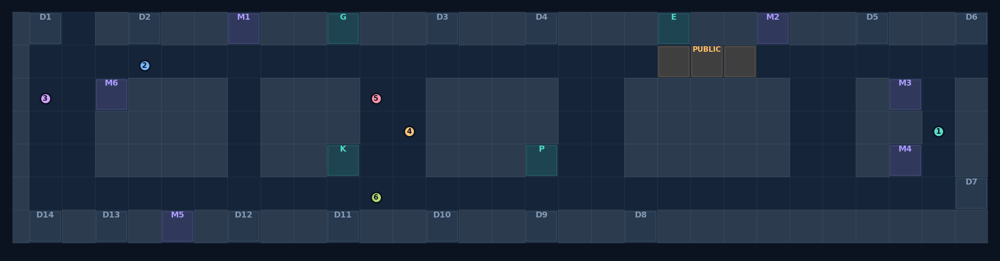
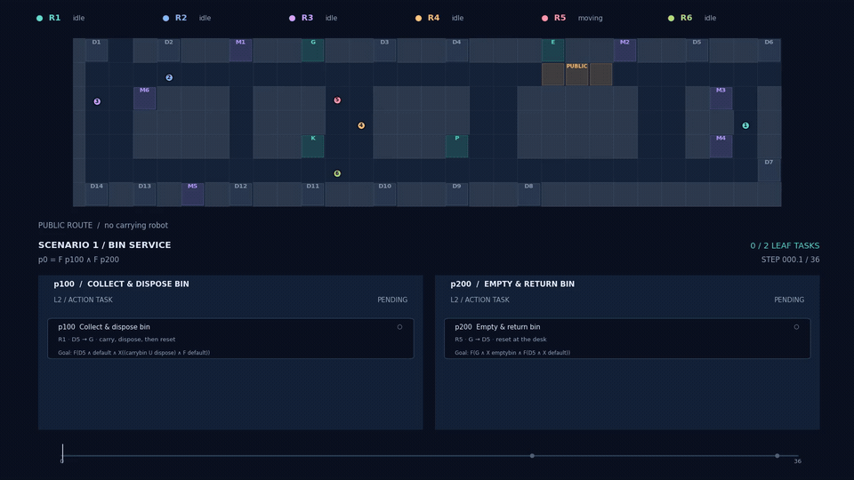
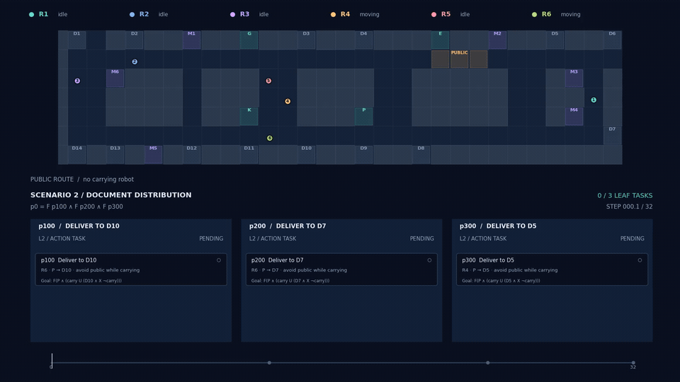
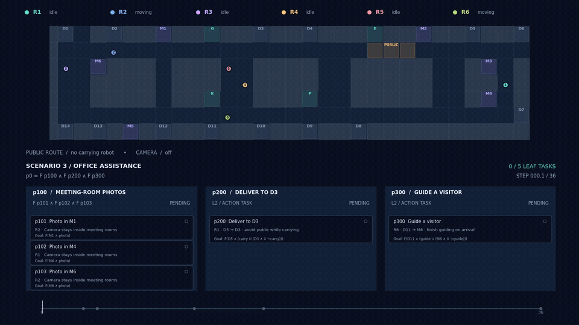
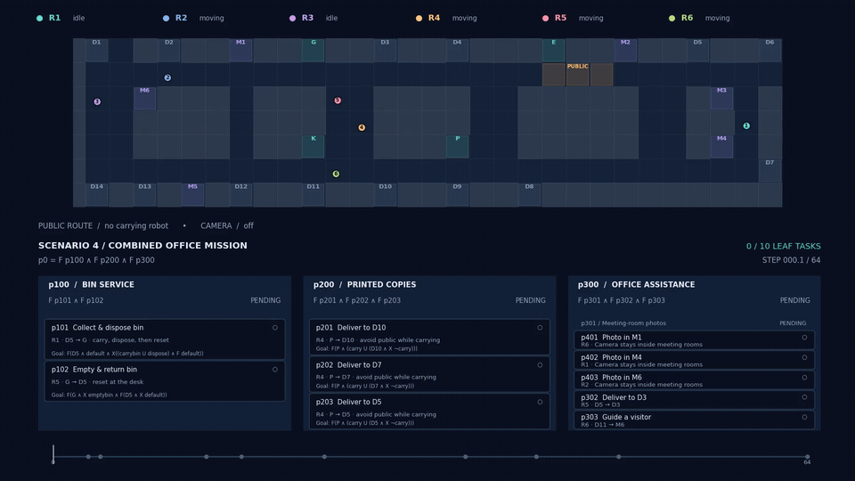
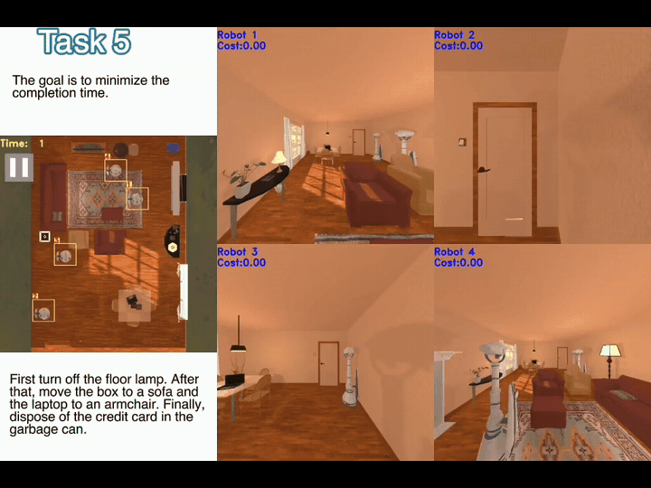

# Simultaneous Task Allocation and Planning for Multi-Robots under Hierarchical Temporal Logic Specifications
Research in robotic planning with temporal logic specifications, such as Linear Temporal Logic (LTL), has relied on single formulas. However, as task complexity increases, LTL formulas become lengthy, making them difficult to interpret and generate, and straining the computational capacities of planners. To address this, we introduce a hierarchical structure for a widely used specification type—LTL on finite traces. The resulting language, termed H-LTL_f, is defined with both its syntax and semantics. We further prove that H-LTL_f is more expressive than its standard “flat” counterparts. Moreover, we conducted a user study that compared the standard LTL_f with our hierarchical version and found that users could more easily comprehend complex tasks using the hierarchical structure. We develop a search-based approach to synthesize plans for multi-robot systems, achieving simultaneous task allocation and planning. This method approximates the search space by loosely interconnected sub-spaces, each corresponding to an LTL_f specification. The search primarily focuses on a single sub-space, transitioning to another under conditions determined by the decomposition of automata. We develop multiple heuristics to significantly expedite the search. Our theoretical analysis, conducted under mild assumptions, addresses completeness and optimality. Compared to existing methods used in various simulators for service tasks, our approach improves planning times while maintaining comparable solution quality.


# Install
 The code is tested using Python 3.10.12.
### Develop via Conda
 Following the instruction:
```bash
cd /path/to/Hierarchical-LTL-STAP
conda env create -f environment.yml
conda activate hierarchical_ltl_stap
```
### Import as package
```bash
cd /path/to/Hierarchical-LTL-STAP
pip install -e .
```
### Install ltl2ba
Download the software `LTL2BA` from this [link](http://www.lsv.fr/~gastin/ltl2ba/index.php), and follow the instructions to generate the exectuable `ltl2ba` and then copy it into the folder `Hierarchical-LTL-Stap`, same hierarchy level with `hierarchical_LTL_stap_on_the_fly.py`.
# Usage
## Input
* Folder [domain](./domain) includes domain files that describe robot and environment action models.
* Scripts [workspace](./hierarchical_ltl_stap/workspace_bosch.py) describes the environment that robots reside in.
* Script [specification.py](./hierarchical_ltl_stap/specification.py) includes hierarchical task specifications.

# Simulation
The simulation environment and tasks are inspired by [Schillinger et al.](https://journals.sagepub.com/doi/abs/10.1177/0278364918774135)
### Environment 




The office building is depicted using a grid-based layout, where areas $d_1$ to $d_{14}$ represent desks, $m_1$ to $m_6$ are meeting rooms, $e$ stands for the elevator, $g$ for the garbage room, $p$ for the printer room, and $k$ for the coffee kitchen. Areas marked as "PUBLIC" indicate public spaces. Obstacles are illustrated in gray. Colored numbered markers identify robots R1–R6 at their initial positions (seed 42), using the same map and colors as the new videos.

### Planner-generated presentation demos

The first four office scenarios are reproduced below with **six robots**, seed
**42**, and the repository's heuristic search (`--cost=minmax`, heuristic weight
100). Each preview links to a **1920 × 1080, 30 fps MP4**. These are newly run
planner paths, with synchronized action and hierarchical-LTL progress.

| Scenario | Planner case | Task | Video |
| --- | --- | --- | --- |
| [1](#scenario-1) | 12 | Bin service | [MP4](demo/generated/scenario_01.mp4) |
| [2](#scenario-2) | 13 | Printed-document distribution | [MP4](demo/generated/scenario_02.mp4) |
| [3](#scenario-3) | 14 | Photos, confidential delivery, and guidance | [MP4](demo/generated/scenario_03.mp4) |
| [4](#scenario-4) | 21 | Combined four-level mission | [MP4](demo/generated/scenario_04.mp4) |

The office map shows numbered robots, recent trails, and their current actions.
Below it, task IDs connect the displayed progress to the formulas: `p0` is the
root, its children summarize sub-missions, and leaf cards represent concrete
robot tasks. Scenario 4 also shows the intermediate photo task `p301` above its
three children. Amber means active, green means completed, and a dim outline
means pending. The timeline marks recorded leaf-completion events.

Public cells are hatched while a robot carries a document or bin. This is a
**robot-specific restriction**: carrying robots must avoid those cells, while
other robots may use them. The camera indicator distinguishes camera/photo
actions in meeting rooms from periods when cameras are off. Leaf-card goal
formulas are compact summaries; the complete formulas, including guards and
next-step requirements, are in the specifications below and each replay JSON.

### Run and replay the first four scenarios

```bash
cd /path/to/Hierarchical-LTL-STAP
conda env create -f environment.yml
conda activate hierarchical_ltl_stap
# Planning requires the ltl2ba executable described above.
python scripts/run_demo_batch.py --cost=minmax
python scripts/render_demo_batch.py
```

The batch defaults to `--cost=minmax` for every scenario. The repository's
`minmax` score emphasizes the maximum estimated per-robot cost using
`0.9 × max(costs) + 0.1 × sum(costs)`; it is not a pure maximum-duration metric.
The heuristic weight remains 100, so these results are not an optimality claim.

The separate Conda environment is named **`hierarchical_ltl_stap`**. This
search-based planner does not require Gurobi. Planner logs and generated outputs
are saved in `data/first_four/`; rendering also copies the videos, GIFs, posters,
portable replays, and validation reports to `demo/generated/` for the README.
Only Scenarios 1–4 are generated. Use `--scenarios 1 3` on either script to rerun
a subset. For a custom output location, pass `--output-dir /path/to/folder` to
both scripts; the renderer also accepts `--publish-dir`.

The included replays can be played without rerunning search or `ltl2ba`:

```bash
conda activate hierarchical_ltl_stap
python -m hierarchical_ltl_stap.demo --replay demo/generated/scenario_01.json
# Export a still or a video from any saved scenario.
python -m hierarchical_ltl_stap.demo --replay demo/generated/scenario_04.json --step 32 --output data/scenario4.png
python -m hierarchical_ltl_stap.demo --replay demo/generated/scenario_04.json --output data/scenario4.mp4
```

Playback controls: **Space** pauses, **Left/Right** step through the plan,
**N/P** jump between task completions, and **R** restarts. Click the timeline to
seek. Interactive playback needs a desktop Matplotlib backend; PNG/MP4 exports
work without a display or LaTeX. Videos use two plan steps per second and hold
the final frame for two seconds.

### Scenario 1 
Empty a paper bin located at desk $d_5$. During this task, the robot must avoid the public area while transporting the bin.

$$
\begin{align*}
 L_1: \quad &  \phi(1,1) =  \Diamond \phi(2,1) \wedge \Diamond\phi(2,2)\\
 L_2: \quad &  \phi(2,1) = \Diamond (d_5 \wedge \mathsf{default} \bigcirc ((\mathsf{carrybin}\  \mathcal{U}\  \mathsf{dispose}) \wedge \Diamond \mathsf{default})) \wedge \square (\mathsf{carrybin \Rightarrow \neg \mathsf{public}})\\
                & \phi(2,2) = \Diamond (g \wedge \bigcirc (g \wedge \mathsf{emptybin}) \wedge \Diamond (d_5 \wedge \bigcirc (d_5 \wedge \mathsf{default})))
\end{align*}
$$

```bash
python hierarchical_LTL_stap_on_the_fly.py --task=nav --case=12 --heuristics --heuristic_weight=100 --domain_file=./domain/domain_bosch.json --cost=minmax --domain=bosch --num_robots=6 --vis --print_step
```
The explanation of arguments can be found in function [create_parser](hierarchical_ltl_stap/util.py).
[](demo/generated/scenario_01.mp4)

[Watch MP4](demo/generated/scenario_01.mp4) · [Poster](demo/generated/scenario_01.png) · [Replay JSON](demo/generated/scenario_01.json) · [Validation report](demo/generated/scenario_01.validation.json)

The two leaf cards correspond to `p100` (collect/carry/dispose/reset) and
`p200` (empty at G and return/reset at D5). The root requires both to complete.
With `minmax`, R5 completes `p200` at step **23**, while R1 completes `p100`
at **35**. Watch R1 take
the longer route around the public cells while carrying the bin.

The repository combines these two children with conjunction and does not impose
a pickup-before-empty ordering between them. Consequently, this run completes
the empty/return child first. The replay preserves that specification rather
than adding an unmodeled physical bin-handling order.


### Scenario 2
Distribute printed copies of a document to desks $d_{10}$, $d_7$, and $d_5$, and avoid public areas while carrying the document. 

$$
\begin{align*}
L_1: \quad &  \phi(1,1) =  \Diamond\phi(2,1) \wedge \Diamond\phi(2,2) \wedge \Diamond\phi(2,3)\\
 L_2: \quad &  \phi(2,1) = \Diamond (p \wedge \mathsf{carry}\  \mathcal{U}\  (d_{10} \wedge \bigcirc \neg \mathsf{carry})) \wedge \square (\mathsf{carry} \Rightarrow \neg \mathsf{public})  \\
 &  \phi(2,2) = \Diamond (p \wedge \mathsf{carry}\  \mathcal{U}\  (d_{7} \wedge \bigcirc \neg \mathsf{carry})) \wedge \square (\mathsf{carry} \Rightarrow \neg \mathsf{public})  \\
 &  \phi(2,3) = \Diamond (p \wedge \mathsf{carry}\  \mathcal{U}\  (d_{5} \wedge \bigcirc \neg \mathsf{carry})) \wedge \square (\mathsf{carry} \Rightarrow \neg \mathsf{public})  
\end{align*}
$$
```bash
python hierarchical_LTL_stap_on_the_fly.py --task=nav --case=13 --heuristics --heuristic_weight=100 --domain_file=./domain/domain_bosch.json --cost=minmax --domain=bosch --num_robots=6 --vis --print_step
```
[](demo/generated/scenario_02.mp4)

[Watch MP4](demo/generated/scenario_02.mp4) · [Poster](demo/generated/scenario_02.png) · [Replay JSON](demo/generated/scenario_02.json) · [Validation report](demo/generated/scenario_02.validation.json)

Three leaf tasks deliver printed copies from **P** to **D10**, **D7**, and
**D5**. Each requires carrying through the route and a following step without
`carry` at delivery. R6 handles D10 and D7, while R4 handles D5. The root
completes when all three leaves finish; the public-area restriction applies
only while a robot is carrying.


### Scenario 3
Take a photo in meeting rooms $m_1$, $m_4$, and $m_6$. The camera should be turned off for privacy reasons when not in meeting rooms. Deliver a document from desk $d_5$ to $d_3$, ensuring it does not pass through any public areas, as the document is internal and confidential. Guide a person waiting at desk $d_{11}$ to meeting room $m_6$.

$$
\begin{align*}
 L_1: \quad &  \phi(1,1) =  \Diamond\phi(2,1) \wedge \Diamond \phi(2,2) \wedge  \Diamond \phi(2,3)\\
 L_2: \quad &  \phi(2,1) = \Diamond \phi(3,1)\wedge \Diamond \phi(3,2)\wedge \Diamond \phi(3,3)\\
  &  \phi(2,2) = \Diamond (d_5 \wedge \mathsf{carry} \  \mathcal{U} \  (d_3 \wedge \bigcirc \neg \mathsf{carry})) \wedge \square (\mathsf{carry} \Rightarrow \neg \mathsf{public}) \\
  &  \phi(2,3) = \Diamond (d_{11}\wedge \mathsf{guide} \  \mathcal{U}\  (m_6 \wedge \bigcirc \neg \mathsf{guide})) \\
 L_3: \quad &  \phi(3,1) = \Diamond(m_1 \wedge \mathsf{photo}) \wedge \square (\neg \mathsf{meeting} \Rightarrow \neg \mathsf{camera} ) \\
 &  \phi(3,2) = \Diamond(m_4 \wedge \mathsf{photo})\wedge \square (\neg \mathsf{meeting} \Rightarrow \neg \mathsf{camera} ) \\
 &  \phi(3,3) = \Diamond(m_6 \wedge \mathsf{photo}) \wedge \square (\neg \mathsf{meeting} \Rightarrow \neg \mathsf{camera} ) \\
 & \mathsf{meeting} := \  m_1 \vee  m_2 \vee  m_3 \vee  m_4 \vee  m_5 \vee  m_6 
% \end{empheq}
\end{align*}
$$
```bash
python hierarchical_LTL_stap_on_the_fly.py --task=nav --case=14 --heuristics --heuristic_weight=100 --domain_file=./domain/domain_bosch.json --cost=minmax --domain=bosch --num_robots=6 --vis --print_step
```
[](demo/generated/scenario_03.mp4)

[Watch MP4](demo/generated/scenario_03.mp4) · [Poster](demo/generated/scenario_03.png) · [Replay JSON](demo/generated/scenario_03.json) · [Validation report](demo/generated/scenario_03.validation.json)

The root has three children: the **photo mission**, **D5 → D3 confidential
delivery**, and **D11 → M6 visitor guidance**. The photo mission itself contains
three leaves, one for each of **M1, M4, and M6**. This makes the hierarchy visible:
individual photo leaves complete the photo parent, which then contributes to
completion of the root. Document carrying avoids public cells, and camera/photo
actions remain inside meeting rooms.

### Scenario 4 
Combinations of scenarios 1, 2 and 3

$$
\begin{align*}
 L_1: \quad &  \phi(1,1) =  \Diamond \phi(2,1) \wedge \Diamond\phi(2,2)  \wedge \Diamond\phi(2,3)\\
 L_2: \quad &  {\phi(2,1) =  \Diamond \phi(3,1) \wedge \Diamond\phi(3,2)} \\
            &  {\phi(2,2) =  \Diamond\phi(3,3) \wedge \Diamond\phi(3,4) \wedge \Diamond\phi(3,5)}\\
            &  {\phi(2,3) =  \Diamond\phi(3, 6) \wedge \Diamond\phi(3, 7) \wedge \Diamond\phi(3, 8)}\\
 L_3: \quad &  {\phi(3,1) = \Diamond (d_5 \wedge \mathsf{default}} {\wedge \bigcirc ((\mathsf{carrybin}\  \mathcal{U}\  \mathsf{dispose}) \wedge \Diamond \mathsf{default}))} \wedge \square (\mathsf{carrybin \Rightarrow \neg \mathsf{public}})\\
                & \phi(3,2) = \Diamond (g \wedge \bigcirc (g \wedge \mathsf{emptybin}) \wedge \Diamond (d_5 \wedge \bigcirc (d_5 \wedge \mathsf{default}))) \\
 & {\phi(3,3) = \Diamond (p \wedge \mathsf{carry}\  \mathcal{U}\  (d_{10} \wedge \bigcirc \neg \mathsf{carry}))} \wedge \square (\mathsf{carry} \Rightarrow \neg \mathsf{public}) \\
 &  {\phi(3,4) = \Diamond (p \wedge \mathsf{carry}\  \mathcal{U}\  (d_{7} \wedge \bigcirc \neg \mathsf{carry}))} \wedge \square (\mathsf{carry} \Rightarrow \neg \mathsf{public})  \\
 &  {\phi(3,5) = \Diamond (p \wedge \mathsf{carry}\  \mathcal{U}\  (d_{5} \wedge \bigcirc \neg \mathsf{carry}))} \wedge \square (\mathsf{carry} \Rightarrow \neg \mathsf{public})  \\ 
                & {\phi(3, 6) = \Diamond  \phi(4, 1) \wedge \Diamond  \phi(4, 2) \wedge \Diamond  \phi(4, 3)} \\
                  & { \phi(3, 7) = \Diamond (d_5 \wedge \mathsf{carry} \  \mathcal{U} \  (d_3 \wedge \bigcirc \neg \mathsf{carry}))} \wedge \square (\mathsf{carry} \Rightarrow \neg \mathsf{public}) \\
  &  {\phi(3, 8) = \Diamond (d_{11}\wedge \mathsf{guide} \  \mathcal{U}\  (m_6 \wedge \bigcirc \neg \mathsf{guide}))} \\
 L_4: \quad &  {\phi(4, 1) = \Diamond(m_1 \wedge \mathsf{photo}) \wedge \square (\neg \mathsf{meeting} \Rightarrow \neg \mathsf{camera} )} \\
 &  {\phi(4, 2) = \Diamond(m_4 \wedge \mathsf{photo})\wedge \square (\neg \mathsf{meeting} \Rightarrow \neg \mathsf{camera} )} \\
 &  {\phi(4, 3) = \Diamond(m_6 \wedge \mathsf{photo}) \wedge \square (\neg \mathsf{meeting} \Rightarrow \neg \mathsf{camera} )} \\
 & {\mathsf{meeting} := \  m_1 \vee  m_2 \vee  m_3 \vee  m_4 \vee  m_5 \vee  m_6   }
 \end{align*}
 $$
 ```bash
python hierarchical_LTL_stap_on_the_fly.py --task=nav --case=21 --heuristics --heuristic_weight=100 --domain_file=./domain/domain_bosch.json --cost=minmax --domain=bosch --num_robots=6 --vis --print_step
```
[](demo/generated/scenario_04.mp4)

[Watch MP4](demo/generated/scenario_04.mp4) · [Poster](demo/generated/scenario_04.png) · [Replay JSON](demo/generated/scenario_04.json) · [Validation report](demo/generated/scenario_04.validation.json)

All three missions run in one four-level hierarchy. The bin and printed-copy
branches are shown beside the office-assistance branch. Within that branch,
`p301` collects the three photo leaves `p401`, `p402`, and `p403`, while `p302`
and `p303` track confidential delivery and guidance. Each parent turns green
only after its required children complete. The root requires **all ten leaf
tasks** and completes at step **64** in the recorded simultaneous execution.

## Simulation in AI2THOR

[](demo/generated/ai2thor.mp4)

[Watch MP4](demo/generated/ai2thor.mp4) · [Poster](demo/generated/ai2thor.png) · [Original recording](https://github.com/user-attachments/assets/d52152d0-2622-4db9-a8fc-1ba5a882ae21)

This is the original AI2THOR demonstration, not a new simulation run. The local
H.264 MP4 retains the original recording's frames, resolution, frame rate, and
audio. Click the animated preview or the MP4 link to open it.

# Citation
```
@article{luo2025simultaneous,
  title={Simultaneous Task Allocation and Planning for Multi-Robots under Hierarchical Temporal Logic Specifications},
  author={Luo, Xusheng and Liu, Changliu},
  journal={IEEE Transaction on Robotics},
  year={2025},
  publisher={IEEE}
}
```

# Related work
```
@article{luo2024decomposition,
  title={Decomposition-based hierarchical task allocation and planning for multi-robots under hierarchical temporal logic specifications},
  author={Luo, Xusheng and Xu, Shaojun and Liu, Ruixuan and Liu, Changliu},
  journal={IEEE Robotics and Automation Letters},
  year={2024},
  publisher={IEEE}
}
@inproceedings{wei2025hierarchical,
  title={Hierarchical Temporal Logic Task and Motion Planning for Multi-Robot Systems},
  author={Wei, Zhongqi and Luo, Xusheng and Liu, Changliu},
  booktitle={Robotics: Science and Systems},
  year={2025}
}
```
